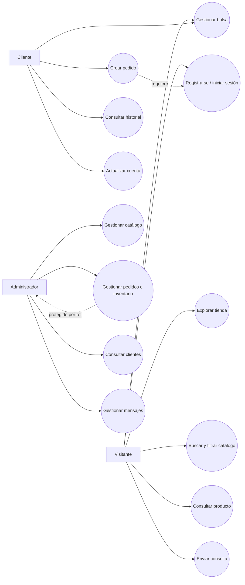
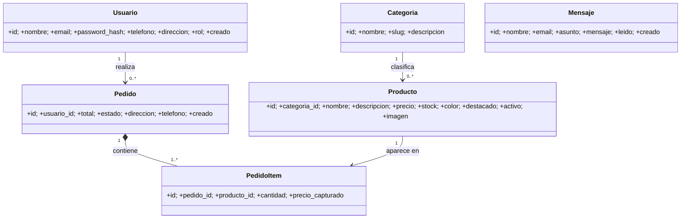
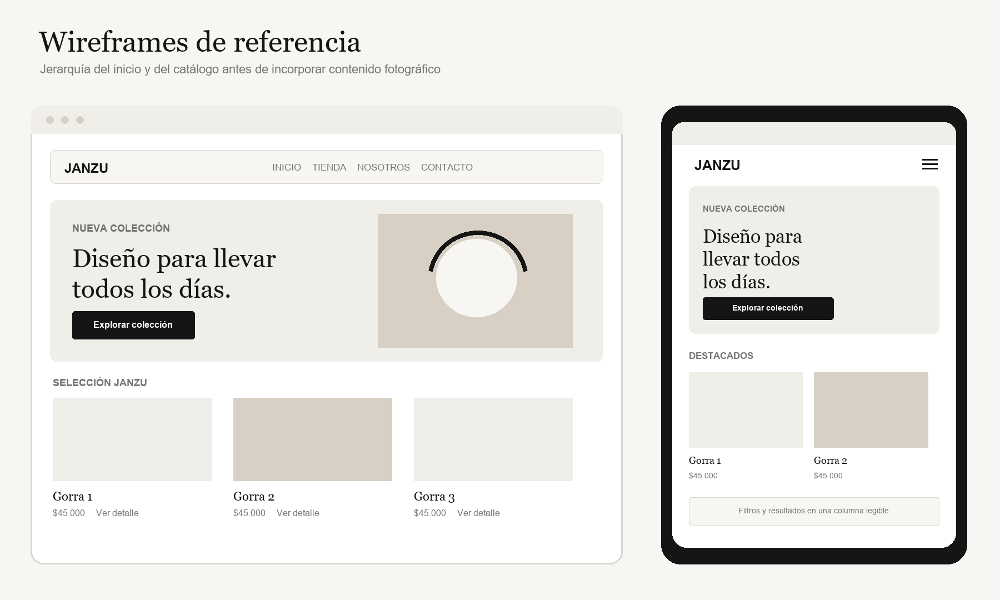

# Proyecto JANZU

## Memoria de planificación, diseño, desarrollo, pruebas y lanzamiento

**Asignatura:** Diseño de Contenido para Interfaces de Usuario (DCIU)  
**Programa:** Tecnología en Desarrollo de Software  
**Sede:** Norte del Cauca  
**Institución:** Universidad del Valle  
**Docente:** Julián A. Balanta S., MSc  
**Estudiante o equipo:** [Completar con nombres reales]  
**Fecha de entrega:** [Completar]  
**Versión del documento:** 1.0

## Resumen ejecutivo

JANZU es un prototipo funcional de comercio electrónico para explorar y pedir gorras desde una interfaz editorial, adaptable y en español. La solución reúne catálogo, filtros, detalle de producto, bolsa lateral, creación de pedidos, cuentas de cliente, contacto y administración. La propuesta de contenido prioriza etiquetas reconocibles, instrucciones concretas, estados visibles y mensajes que ayudan a continuar una tarea.

La aplicación usa PHP, MySQL/MariaDB, PDO, HTML, CSS y JavaScript, y está preparada para ejecutarse en Laragon. El pago y la logística se coordinan fuera del prototipo: el sistema registra pedidos y descuenta inventario, pero no procesa pagos ni genera guías de envío.

Este expediente organiza el trabajo según las cinco etapas de la guía DCIU. Los requisitos, el diseño y el plan de pruebas describen el sistema entregado. Las entrevistas, los resultados de pruebas con personas, las capturas fechadas, la identidad legal de una empresa y la evaluación automática externa deben completarse con datos y evidencias reales del equipo antes de presentar la versión final; no se reportan como hechos si no se han realizado.

## Ficha de entrega

| Campo | Información |
|---|---|
| Proyecto | JANZU Headwear Collection |
| Módulo | Tienda en línea y gestión de pedidos de gorras |
| Requerimientos relacionados | RF01–RF15, definidos en este documento |
| Historias relacionadas | HU01–HU10, definidas en este documento |
| Responsable de entrega | [Completar] |
| Fecha de entrega | [Completar] |
| Versión evaluada | 1.0 |
| URL local | `http://localhost/janzu/` o `http://janzu.test/` |

## 1. Planificación

### 1.1 Empresa desarrolladora

#### 1.1.1 Nombre y razón social

**Nombre para el proyecto académico:** Equipo de desarrollo JANZU DCIU.  
**Razón social:** No aplica; el equipo desarrolla un prototipo académico y no se presenta como una sociedad legalmente constituida.  
**Integrantes:** [Completar nombres, programa y responsabilidades reales].

#### 1.1.2 Elementos de identificación

La identidad principal implementada corresponde al producto cliente **JANZU Headwear Collection**. Para evitar confundir al desarrollador con el cliente, el equipo académico se identifica en documentos como “Equipo de desarrollo JANZU DCIU”. No se atribuye al equipo una marca comercial ni un logotipo empresarial registrado.

**Frase de trabajo del equipo:** “Diseño y contenido para compras digitales más claras”. Es una frase descriptiva para el ejercicio académico, no un eslogan comercial registrado.

#### 1.1.3 Quiénes somos

Somos el equipo académico responsable de investigar, especificar, diseñar, implementar y validar un prototipo de comercio electrónico. El trabajo integra desarrollo web con arquitectura de información, escritura UX, accesibilidad y pruebas. La composición nominal del equipo se debe completar con los nombres de quienes participaron realmente.

#### 1.1.4 Visión

Construir soluciones digitales sencillas de aprender, mantenibles y respetuosas con las necesidades de las personas, aplicando criterios de accesibilidad y contenido claro desde el diseño hasta las pruebas.

#### 1.1.5 Portafolio de servicios del equipo

- Análisis de necesidades y requisitos para productos digitales.
- Investigación exploratoria y preparación de pruebas de usabilidad.
- Arquitectura de información, wireframes y prototipos de interfaz.
- Estrategia de contenido, microcopias y mensajes de interacción.
- Desarrollo de prototipos web con PHP y MySQL.
- Pruebas funcionales, documentación y mantenimiento del prototipo.

Este portafolio describe las capacidades ejercitadas en el curso; no es una oferta comercial de una empresa constituida.

#### 1.1.6 Organigrama y responsabilidades

| Rol | Responsable | Responsabilidades |
|---|---|---|
| Coordinación / responsable de entrega | [Completar] | Alcance, cronograma, comunicación con docente y consolidación de entregables. |
| Análisis y contenido UX | [Completar] | Requisitos, entrevistas, arquitectura, voz, microcopias y manual editorial. |
| Diseño de interfaz y accesibilidad | [Completar] | Sistema visual, wireframes, adaptación a tamaños y revisión de teclado. |
| Desarrollo e integración | [Completar] | PHP, JavaScript, CSS, base de datos e integración. |
| Pruebas y documentación | [Completar] | Casos de prueba, registro de resultados, manuales y anexos. |

Si el trabajo lo realiza una sola persona, se registra su nombre en cada rol asumido en lugar de crear integrantes ficticios.

#### 1.1.7 Proveedores

Para el prototipo, “proveedores” significa proveedores de herramientas y plataforma; no se identificaron proveedores comerciales de gorras.

| Servicio o herramienta | Uso en el proyecto | Dependencia |
|---|---|---|
| Laragon | Entorno local integrado para Windows. | Apache, PHP y MySQL/MariaDB configurados. |
| Apache | Servir las páginas PHP en el entorno local. | Incluido en Laragon. |
| PHP y extensión PDO MySQL | Lógica de aplicación y acceso a datos. | PHP 8.0 o superior con extensiones requeridas. |
| MySQL o MariaDB | Persistencia de cuentas, catálogo, pedidos y mensajes. | Motor compatible y tablas InnoDB. |
| HeidiSQL | Administración e importación de SQL local. | Acceso local al servicio de base de datos. |
| Git y GitHub | Control de versiones y repositorio del proyecto. | Conectividad para sincronizar cambios. |

#### 1.1.8 Infraestructura física y tecnológica

El entorno de desarrollo y demostración previsto es un computador con Windows y Laragon, navegador actualizado y acceso al repositorio. La aplicación se ejecuta localmente con PHP 8.0 o superior, PDO MySQL, `mbstring`, `fileinfo`, sesiones y JSON; la base requiere MySQL 5.7+ o MariaDB 10.3+ y tablas InnoDB. Para una publicación real se necesitarían alojamiento HTTPS, respaldo periódico, monitoreo, correo transaccional y gestión segura de credenciales.

#### 1.1.9 Desarrollos y logros del equipo

El resultado técnico documentado para el curso es el prototipo JANZU descrito en las etapas 2 y 3: catálogo con filtros, bolsa de compra, cuentas, gestión de inventario y pedidos, administración y formularios de contacto. La sección de logros no atribuye métricas de ventas ni usuarios reales porque el prototipo no se presenta como comercio activo.

### 1.2 Cliente

#### 1.2.1 Nombre y razón social

**Nombre de marca usado en el prototipo:** JANZU Headwear Collection.  
**Razón social:** No se aportó documentación que acredite una empresa registrada. En esta entrega, JANZU se trata como marca de un caso académico, no como una sociedad comercial verificada.

#### 1.2.2 Elementos de marca del cliente

| Elemento | Definición aplicada |
|---|---|
| Nombre | JANZU |
| Descriptor | Headwear Collection |
| Frase de marca | “Diseño para llevar todos los días”. |
| Voz | Serena, segura, directa, útil e incluyente. |
| Negro tinta | `#151515`; titulares, navegación y acciones principales. |
| Marfil | `#F7F6F2`; fondo base. |
| Arena | `#D8D0C4`; superficies y acentos suaves. |
| Gris | `#747474`; texto secundario y metadatos. |
| Blanco | `#FFFFFF`; tarjetas y contraste de superficies. |
| Tipografía editorial | Georgia para títulos y encabezados. |
| Tipografía de lectura | Inter con alternativas Helvetica Neue y Arial; texto de interfaz sans serif. |

#### 1.2.3 Portafolio de productos

La tienda organiza gorras por categorías de edad: Adultos, Jóvenes y Niños. Los productos de ejemplo representan siluetas clásicas, urbanas, deportivas, trucker e infantiles. Nombres, precios, colores e inventario de la base SQL son datos de muestra y deben revisarse antes de una presentación pública o una venta real.

### 1.3 Definición del proyecto

#### 1.3.1 Problema o necesidad

Un cliente necesita conocer la oferta de gorras, comparar opciones y consultar disponibilidad sin depender de una conversación informal para cada producto. El equipo necesita un prototipo que permita recorrer ese proceso con mensajes comprensibles y un mecanismo consistente para registrar los pedidos.

#### 1.3.2 Descripción general del problema

Cuando la información del catálogo, el inventario y los pedidos se presenta de forma dispersa, la persona puede dudar sobre qué comprar, qué datos entregar o si el pedido quedó registrado. La solución agrupa el contenido, los pasos de compra y la administración en una aplicación web con estados y acciones identificables.

#### 1.3.3 Situación actual

El código entregado implementa un sitio PHP/MySQL local. El catálogo consulta productos y categorías; la bolsa se conserva en sesión; el pedido requiere una cuenta; el sistema guarda el pedido y sus líneas en una transacción; el panel permite gestionar catálogo, clientes, pedidos y mensajes. La aplicación no está conectada a una pasarela de pago ni a un operador de envíos.

#### 1.3.4 Situación esperada

Una persona visitante puede entender qué ofrece JANZU, encontrar productos, revisar disponibilidad y preparar una bolsa. Al autenticarse, puede registrar un pedido, consultar su historial y actualizar sus datos. El administrador autorizado puede mantener el catálogo, revisar pedidos y mensajes, y gestionar el inventario sin dejar que el stock sea negativo.

#### 1.3.5 Justificación de la solución

Una tienda web permite reunir catálogo, filtros, información del producto y pedido en una experiencia verificable en navegador. PHP y MySQL se ajustan al entorno Laragon disponible y al nivel de complejidad académica. PDO con consultas preparadas, sesiones y transacciones atiende operaciones sensibles sin añadir un framework que complique la instalación local.

#### 1.3.6 Alcance del producto

**Incluye:** navegación pública, inicio, catálogo con búsqueda y filtros, página de producto, bolsa lateral y página de bolsa, registro e inicio de sesión, datos de cuenta, historial de pedidos, contacto, carga de imágenes en administración, gestión de productos y categorías existentes, actualización de estado de pedidos, administración de clientes y mensajes, persistencia MySQL y migraciones incrementales.

**Fuera del alcance actual:** pagos con tarjeta o billetera, facturación electrónica, integración de transportadoras, seguimiento del envío, reembolsos automáticos, correo transaccional, recuperación de contraseña por correo, analítica de producción, despliegue público y gestión legal/comercial de inventario real. El cliente y el administrador deben coordinar pago y despacho por un canal externo antes de atender un pedido real.

#### 1.3.7 Responsables e involucrados

| Nombre | Tipo | Rol / interés |
|---|---|---|
| [Completar] | Responsable | Estudiante o coordinador del proyecto. |
| [Completar] | Responsable | Diseño de contenido, interfaz y pruebas; completar si aplica. |
| [Completar] | Responsable | Desarrollo e integración; completar si aplica. |
| Julián A. Balanta S. | Involucrado | Docente de la asignatura DCIU; orientación y evaluación académica. |
| Personas invitadas a evaluar | Involucrado | Participantes de pruebas; registrar nombres o códigos anonimizados y consentimiento. |
| Cliente / representante de JANZU | Involucrado | [Completar solo si existe una persona real que haya validado el alcance]. |

#### 1.3.8 Restricciones y supuestos

- El prototipo se instala localmente en Laragon y usa PHP, Apache y MySQL/MariaDB.
- Los nombres, precios e inventario iniciales son datos de demostración; no representan compromisos comerciales.
- El desarrollo está condicionado por el plazo académico y el equipo indicado en la portada.
- No se realiza cobro ni despacho dentro de la aplicación.
- El administrador inicial se habilita manualmente modificando el rol de una cuenta; no hay creación pública de cuentas administradoras.
- La privacidad de usuarios reales exige autorización, uso mínimo de datos y eliminación de información de prueba al cerrar la evaluación.
- La compatibilidad con navegadores y la conformidad de accesibilidad se deben declarar únicamente después de ejecutar las pruebas definidas en la etapa 4.

#### 1.3.9 Objetivo general

Diseñar, implementar y validar un prototipo de tienda web de gorras que permita descubrir el catálogo y registrar pedidos mediante una interfaz adaptable, accesible y con contenido claro para sus usuarios.

### 1.4 Comunicación interna y externa

| Canal | Uso | Responsable | Evidencia |
|---|---|---|---|
| Correo institucional | Entregas, solicitudes formales y comunicaciones con el docente. El correo docente publicado en la guía es `julian.alexis@correounivalle.edu.co`. | Coordinación del proyecto: [completar]. | Correo enviado/recibido con fecha y asunto. |
| Reunión presencial o virtual | Revisión de requisitos, decisiones y avances del equipo. | Coordinación: [completar]. | Acta breve con asistentes, acuerdos y pendientes. |
| Repositorio GitHub | Control y revisión del código; no usar para contraseñas ni datos personales reales. | Responsable de repositorio: [completar]. | Enlace, commit y fecha de integración. |
| Canal acordado con participantes | Invitación y coordinación de pruebas de usabilidad. | Responsable de investigación: [completar]. | Consentimiento y notas anonimizadas. |

Se eligen canales institucionales para evaluaciones y entregas formales, reuniones con acta para conservar decisiones, y Git para auditar cambios del código.

### 1.5 Cronograma de referencia

El cronograma es una secuencia de ocho semanas académicas. Se deben sustituir “Semana 1–8” por fechas reales de inicio y cierre, y asignar responsables nominales antes de entregar.

| Actividad | S1 | S2 | S3 | S4 | S5 | S6 | S7 | S8 |
|---|:---:|:---:|:---:|:---:|:---:|:---:|:---:|:---:|
| Planeación, alcance y perfiles | X |  |  |  |  |  |  |  |
| Revisión de documentos e investigación | X | X |  |  |  |  |  |  |
| Requisitos, historias y casos de uso |  | X | X |  |  |  |  |  |
| Arquitectura, modelo de datos y wireframes |  |  | X | X |  |  |  |  |
| Diseño de contenido y accesibilidad |  |  | X | X | X |  |  |  |
| Desarrollo e integración |  |  |  | X | X | X |  |  |
| Pruebas funcionales, de enlaces y dispositivos |  |  |  |  |  | X | X |  |
| Evaluación de usabilidad y ajustes |  |  |  |  |  |  | X | X |
| Manuales, anexos y entrega final |  |  |  |  |  |  | X | X |

## 2. Diseño e investigación de contenido

### 2.1 Ciclo de vida

Se adopta un ciclo iterativo e incremental. Cada incremento entrega una parte verificable: primero navegación y catálogo; luego cuenta, bolsa y pedido; después administración, seguridad y documentación. Al cierre de cada incremento se revisan requisitos, contenido, interfaz, funcionamiento y defectos. Los cambios de alcance se registran con fecha y motivo.

### 2.2 Investigación y revisión documental

La guía DCIU, el código PHP y el esquema SQL son fuentes documentales del alcance. Para comprender a las personas usuarias, el equipo aplicará entrevistas breves y una prueba de tareas con participantes que compren accesorios en línea o usen con frecuencia tiendas digitales.

**Estado de evidencia:** no se suministraron entrevistas, encuestas, consentimiento ni resultados de pruebas humanas. Por eso esta sección entrega el instrumento y las preguntas de investigación; no presenta respuestas simuladas como hallazgos. Antes de afirmar resultados, registrar fecha, perfil general, número real de participantes, consentimiento, hallazgos y decisiones que cambiaron el diseño.

**Preguntas de investigación**

1. ¿Qué información necesita una persona para decidir si una gorra le sirve?
2. ¿Cómo espera encontrar una pieza entre varias categorías y precios?
3. ¿Qué le genera confianza antes de registrar un pedido?
4. ¿Qué términos usa para describir talla, ajuste, material y estado del pedido?
5. ¿Qué barreras experimenta al comprar desde un teléfono o con teclado?

**Guion breve de entrevista**

- Cuéntame la última vez que buscaste una gorra o un accesorio en línea.
- ¿Qué información revisaste antes de decidirte?
- ¿Qué te hizo continuar o abandonar la compra?
- ¿Qué esperas ver al añadir un producto a la bolsa?
- ¿Qué esperas que ocurra al confirmar un pedido?
- ¿Hay algo de la experiencia que sea difícil de leer, entender o usar?

**Registro de sesión:** código anonimizado `[P01]`; fecha `[ ]`; modalidad `[ ]`; consentimiento `[sí/no]`; perfil relevante para la tarea `[ ]`; notas textuales sin datos sensibles `[ ]`; hallazgos `[ ]`; decisión de diseño derivada `[ ]`.

**Revisión de documentos realizada:** guía de proyecto DCIU y estructura entregada de la aplicación (páginas PHP, hojas CSS/JS, SQL de instalación, migraciones y pruebas). La guía del curso se usa para ordenar esta memoria y su lista de comprobación.

### 2.3 Especificación de requisitos de software

Prioridades: **Alta** = esencial para el flujo principal; **Media** = aporta gestión o claridad; **Baja** = mejora que no bloquea el flujo de compra.

#### 2.3.1 Requisitos funcionales

| ID | Funcionalidad | Descripción verificable | Usuario | Tipo |
|---|---|---|---|---|
| RF01 | Explorar inicio | Mostrar propuesta de marca, acceso a colecciones y productos destacados activos. | Visitante / cliente | Esencial |
| RF02 | Consultar catálogo | Listar productos activos y paginar resultados. | Visitante / cliente | Esencial |
| RF03 | Buscar y filtrar | Buscar por texto y filtrar por categoría, precio y disponibilidad; ordenar por destacados, recientes, precio o nombre. | Visitante / cliente | Esencial |
| RF04 | Ver producto | Presentar nombre, imagen, descripción, precio, categoría y stock disponible. | Visitante / cliente | Esencial |
| RF05 | Gestionar bolsa | Añadir, cambiar cantidad y quitar productos; limitar unidades al stock y recalcular totales. | Visitante / cliente | Esencial |
| RF06 | Crear cuenta | Registrar nombre, correo, contraseña y datos de contacto validados; rechazar correos duplicados. | Visitante | Esencial |
| RF07 | Autenticarse y salir | Iniciar sesión con credenciales válidas, asignar permisos según rol y cerrar sesión mediante acción protegida. | Cliente / administrador | Esencial |
| RF08 | Registrar pedido | Exigir una cuenta, dirección y teléfono válidos; guardar pedido y líneas en una transacción y descontar el inventario disponible. | Cliente | Esencial |
| RF09 | Consultar cuenta e historial | Consultar pedidos propios, actualizar perfil y cambiar contraseña verificando la actual. | Cliente | Esencial |
| RF10 | Enviar consulta | Validar y guardar nombre, correo, asunto y mensaje desde el formulario de contacto. | Visitante / cliente | Media |
| RF11 | Mantener productos | Crear y actualizar productos, categoría, precio, stock, color, estado, destacado e imagen; ocultar/activar un producto. | Administrador | Esencial |
| RF12 | Gestionar pedidos | Consultar pedidos y cambiar estado; cancelar devuelve inventario una sola vez, y reabrir valida stock disponible. | Administrador | Esencial |
| RF13 | Consultar clientes | Ver cuentas con rol cliente y datos de actividad resumidos. | Administrador | Media |
| RF14 | Gestionar mensajes | Consultar mensajes recibidos y marcar un mensaje como leído. | Administrador | Media |
| RF15 | Proteger operaciones | Validar CSRF en acciones de escritura y limitar rutas administrativas por rol. | Sistema | Esencial |

#### 2.3.1.1 Clasificación y detalle de requisitos

| ID | Nombre | Descripción / criterios principales | Prioridad |
|---|---|---|---|
| RF01 | Inicio editorial | El inicio orienta a tienda, categorías e información institucional; sólo muestra productos activos. | Alta |
| RF02 | Catálogo paginado | La lista respeta estado activo y la página elegida; una página vacía ofrece volver a explorar. | Alta |
| RF03 | Búsqueda, filtros y orden | Combina filtros válidos y conserva los criterios al pasar de página; ignora valores de orden no permitidos. | Alta |
| RF04 | Detalle de producto | Si el id no existe o el producto está inactivo, informa que no está disponible y ofrece volver al catálogo. | Alta |
| RF05 | Bolsa | Conserva la selección en sesión; para producto agotado o cantidad superior al stock informa el límite y no crea unidades inválidas. | Alta |
| RF06 | Registro | Normaliza entradas, valida formato de correo y longitud de contraseña; los errores se muestran junto al campo. | Alta |
| RF07 | Acceso y salida | Verifica hashes de contraseñas; tras autenticar regenera la sesión y conserva rol y cuenta; las acciones de escritura requieren token. | Alta |
| RF08 | Pedido | Requiere usuario autenticado, dirección de mínimo 8 caracteres, teléfono y bolsa no vacía; bloquea productos, valida stock y confirma todo junto o revierte todo. | Alta |
| RF09 | Cuenta | El cliente sólo consulta sus pedidos; cambio de contraseña pide contraseña actual, coincidencia y longitud mínima establecida en interfaz. | Alta |
| RF10 | Contacto | Valida campos y persiste en tabla `mensajes`; confirma recepción sin exponer error SQL ni datos internos. | Media |
| RF11 | Administración de catálogo | Sólo rol `admin`; valida categoría y precio/stock; archivo se limita a JPG, PNG o WEBP hasta 2 MB. | Alta |
| RF12 | Administración de pedidos | Las transiciones se confirman con control transaccional de inventario; cancelación repetida no reintegra stock dos veces. | Alta |
| RF13 | Administración de clientes | El panel consulta rol cliente; no expone contraseña ni permite consultar cuentas fuera del permiso administrativo. | Media |
| RF14 | Mensajes | El panel presenta información recibida y permite cambiar `leido`; escritura con POST protegido por CSRF. | Media |
| RF15 | Controles de seguridad | Todas las salidas se escapan, consultas se preparan, formularios de escritura incluyen token CSRF y el panel verifica privilegio. | Alta |

### 2.3.2 Requisitos no funcionales

Las cifras de tiempo siguientes son objetivos de diseño y deben medirse en una prueba con base y equipo documentados; no se presentan como rendimiento ya medido.

| Código / atributo | Requisito verificable |
|---|---|
| RNF01 Usabilidad | Una persona que use tiendas web debería completar búsqueda, filtro y añadir a la bolsa en menos de 3 minutos durante una sesión guiada, sin asistencia. Registrar tiempo y errores. |
| RNF02 Claridad de contenido | Etiquetas, instrucciones y errores deben estar en español claro, nombrar el campo o la acción y sugerir un paso de recuperación. |
| RNF03 Confiabilidad | La creación de pedido y ajuste de stock se confirman o revierten juntos; no debe quedar un pedido parcial por error de base de datos. |
| RNF04 Integridad | Un pedido no puede descontar más unidades que el stock disponible. La cancelación reintegra unidades una vez. |
| RNF05 Seguridad | Contraseñas almacenadas como hash; consultas PDO preparadas; tokens CSRF en escritura; rol admin requerido para panel; salida HTML escapada. |
| RNF06 Privacidad | Recopilar sólo nombre, correo, teléfono y dirección necesarios para cuenta/pedido; usar datos ficticios en demostración y retirar datos de pruebas. |
| RNF07 Eficiencia | Objetivo local: 95 % de solicitudes de páginas públicas con 1000 productos de prueba en menos de 2 s en el equipo de referencia; medir con caché y versión documentadas. |
| RNF08 Capacidad | Prototipo académico validado con una instancia local y catálogo de muestra; concurrencia de producción no está certificada. Como objetivo de prueba, validar 10 sesiones de lectura concurrentes sin error HTTP. |
| RNF09 Portabilidad | El mismo código debe ejecutarse en Laragon para Windows con PHP 8.0+ y MySQL/MariaDB compatibles, sin rutas absolutas al directorio personal. |
| RNF10 Mantenibilidad | Configuración local fuera de Git; funciones comunes en `includes/`; SQL de instalación separado de migraciones numeradas; instrucciones para respaldo y actualización. |
| RNF11 Soportabilidad | La instalación debe poder completarse con el README; registrar error, página, paso y hora para reproducir incidentes; las respuestas no deben mostrar stack traces a usuario final. |
| RNF12 Operatividad | Aplicación detrás de Apache; base de datos InnoDB; en despliegue real usar HTTPS, usuario SQL de privilegio mínimo, respaldos probados y registro de errores protegido. |
| RNF13 Accesibilidad | Objetivo de diseño: cubrir principios WCAG 2.2 nivel AA para etiquetas, teclado, foco visible, contraste y reflujo; declarar conformidad sólo tras evaluación manual y automática completa. |
| RNF14 Compatibilidad | Probar en Chrome, Edge y Firefox actualizados y en vistas de 1440 px, 768 px y 390 px; anotar dispositivo, versión y resultado real. |

### 2.4 Usuarios y roles

#### 2.4.1 Visitante

Persona sin sesión autenticada. Puede explorar páginas públicas, buscar y filtrar el catálogo, consultar productos, preparar la bolsa y enviar un mensaje. Para crear un pedido, la interfaz le solicita iniciar sesión o registrarse.

#### 2.4.2 Cliente

Persona con cuenta autenticada. Puede completar el pedido, consultar su historial, editar su nombre y datos de contacto y cambiar la contraseña. Sólo puede consultar sus propios pedidos.

#### 2.4.3 Administrador

Persona autenticada con rol `admin`, habilitada por el responsable de base de datos. Puede usar el panel para mantener productos, revisar pedidos, consultar clientes, ver mensajes y marcar mensajes como leídos. El rol no se concede mediante registro público.

#### 2.4.4 Responsable de operación

Rol organizativo del proyecto, no rol separado de la aplicación. Revisa que el catálogo de demostración esté actualizado, que los datos de cuenta sean ficticios durante la evaluación y que los pedidos de prueba se limpien sólo después de respaldarlos.

### 2.5 Diagrama de casos de uso

#### 2.5.1 Diagrama general



#### 2.5.2 Subsistemas específicos

**Catálogo y compra:** explorar → filtrar → consultar detalle → añadir unidades → revisar bolsa → autenticarse → completar dirección y teléfono → crear pedido → recibir confirmación y consultar el estado. Si el stock no alcanza, el sistema informa la cantidad disponible y conserva un estado coherente.

**Administración:** iniciar sesión como administrador → abrir tablero → elegir productos, pedidos, clientes o mensajes → validar formulario → confirmar cambio → actualizar tablero. La transición que afecta inventario se procesa en transacción y bloquea stock insuficiente.

Los diagramas específicos son una descomposición de los flujos del diagrama general; los nombres de casos coinciden con los requisitos RF.

### 2.6 Historias de usuario

| ID / peso | Historia | Flujo principal | Criterios de aceptación |
|---|---|---|---|
| HU01 / 5 | Como visitante, quiero crear una cuenta para guardar mis datos y registrar pedidos. | Abrir registro → diligenciar campos → enviar → cuenta creada o errores asociados a campos. | A1: correo válido y único crea cuenta cliente. A2: correo duplicado muestra solución sin crear registro. A3: contraseña menor a 10 caracteres se rechaza. |
| HU02 / 5 | Como cliente, quiero iniciar y cerrar sesión para acceder a mis funciones de manera segura. | Abrir acceso → ingresar correo y clave → validar → entrar; salir desde acción POST. | A1: credenciales válidas abren cuenta. A2: inválidas muestran mensaje genérico, no revelan qué cuenta existe. A3: la salida termina la sesión. A4: cuenta cliente no abre administración. |
| HU03 / 5 | Como visitante, quiero encontrar una gorra por nombre, categoría, precio o disponibilidad. | Abrir tienda → elegir filtros/orden → revisar resultados/paginación. | A1: los filtros combinados devuelven resultados que cumplen todos. A2: orden muestra secuencia solicitada. A3: búsqueda sin coincidencias muestra estado vacío y forma de limpiar filtros. |
| HU04 / 5 | Como visitante, quiero ver los detalles de una gorra y añadirla a la bolsa. | Abrir tarjeta → revisar detalle → indicar unidades → añadir. | A1: detalle presenta nombre, imagen alternativa, precio y stock. A2: unidades válidas actualizan contador y subtotal. A3: agotado o cantidad superior a stock no se puede añadir. |
| HU05 / 5 | Como cliente, quiero confirmar un pedido para que la tienda registre los productos elegidos. | Revisar bolsa → ingresar dirección y teléfono → confirmar → ver mensaje y pedido en historial. | A1: bolsa vacía no crea pedido. A2: teléfono/dirección inválidos producen mensaje claro. A3: si stock cambia antes del envío, no hay pedido parcial ni stock negativo. A4: pedido correcto aparece con total e ítems correctos. |
| HU06 / 4 | Como cliente, quiero revisar mis datos y pedidos para conocer el estado de mis compras. | Abrir cuenta → ver perfil o pedidos → actualizar datos o cambiar contraseña. | A1: se muestran sólo pedidos de la cuenta autenticada. A2: cambio de perfil guarda los campos válidos. A3: contraseña nueva requiere verificar la actual y confirmar coincidencia. |
| HU07 / 3 | Como visitante, quiero enviar una consulta para recibir orientación sobre la tienda. | Abrir contacto → completar campos → enviar → recibir confirmación. | A1: correo inválido o campos obligatorios vacíos se rechazan. A2: mensaje válido queda visible en administración. A3: texto introducido no se ejecuta como HTML. |
| HU08 / 5 | Como administrador, quiero crear, actualizar y ocultar productos para mantener el catálogo vigente. | Entrar como admin → catálogo → editar campos/subir imagen → guardar. | A1: rol cliente recibe acceso denegado. A2: datos válidos se guardan y aparecen en catálogo si activo. A3: archivo distinto a JPG/PNG/WEBP o mayor a 2 MB se rechaza. |
| HU09 / 5 | Como administrador, quiero cambiar estados de pedidos y mantener el inventario consistente. | Abrir pedido → elegir estado → confirmar cambio. | A1: cancelación reintegra stock sólo una vez. A2: reabrir pedido valida existencias. A3: envío/entrega no se cancelan por un estado no permitido. A4: fallos revierten el cambio completo. |
| HU10 / 3 | Como administrador, quiero revisar clientes y consultas para responder desde el canal operativo. | Abrir sección → consultar lista → marcar mensaje leído. | A1: el panel sólo muestra sus datos permitidos. A2: el mensaje marcado cambia de estado una vez. A3: una persona no administradora no accede a la sección. |

### 2.7 Diagrama de clases y modelo conceptual

La aplicación actual usa PHP procedural y funciones compartidas, no clases de dominio. El siguiente diagrama representa las entidades conceptuales y relaciones de persistencia, no una afirmación de que existan clases PHP con estos nombres.



**Reglas de datos:** `usuarios.email` es único; `productos.categoria_id` refiere a categorías; pedidos pertenecen a usuarios; cada línea conserva el precio aplicado en el momento de compra; InnoDB mantiene relaciones y transacciones; mensajes no requieren cuenta.

### 2.8 Herramientas y tecnologías

| Tecnología | Uso | Versión / condición |
|---|---|---|
| PHP | Lógica de páginas y formularios. | 8.0+; se recomienda usar la versión configurada en Laragon y registrarla en pruebas. |
| PDO MySQL | Consultas preparadas, transacciones y conexión SQL. | Extensión `pdo_mysql` activa. |
| MySQL / MariaDB | Datos persistentes y motor transaccional. | MySQL 5.7+ o MariaDB 10.3+; tablas InnoDB. |
| Apache / Laragon | Servidor local y entorno de demostración. | Configuración local descrita en README. |
| HTML5 / CSS | Estructura semántica y estilos adaptables. | Sin framework UI externo. |
| JavaScript | Menú móvil, bolsa lateral y mejoras de interacción. | Degradación funcional apoyada por formularios HTML. |
| HeidiSQL | Importar SQL y administrar base local. | Herramienta de administración. |
| Git / GitHub | Versionamiento y colaboración. | Nunca almacenar credenciales en el repositorio. |

### 2.9 Arquitectura de información

```text
Inicio
├── Tienda
│   ├── Colección / categorías
│   ├── Búsqueda, filtros y orden
│   └── Producto
│       └── Añadir a bolsa
├── Tu bolsa
│   └── Crear pedido (requiere sesión)
├── Nosotros
├── Contacto
├── Entrar
│   ├── Crear cuenta
│   └── Mi cuenta
│       ├── Mis datos / contraseña
│       └── Mis pedidos
└── Panel (sólo administrador)
    ├── Resumen
    ├── Productos
    ├── Pedidos
    ├── Clientes
    └── Mensajes
```

La navegación mantiene enlaces principales de tienda, marca y contacto; cuenta y bolsa se presentan como acciones del encabezado. El menú cambia a control accesible en pantallas pequeñas. Las rutas administrativas sólo se ofrecen al rol autorizado.

### 2.10 Diseño de interfaz gráfica

El diseño usa marfil, negro tinta, arena y gris; Georgia para títulos y una sans serif para lectura. El encabezado, la bolsa lateral, las tarjetas y los formularios mantienen etiquetas y acciones consistentes. La jerarquía prioriza imagen, nombre, precio y acción de compra. En móvil, navegación y contenido se reorganizan; CSS define puntos de adaptación en 1000, 760 y 480 px. Los estados usan texto además del color.

### 2.11 Planificación de interfaces UI/UX

| Interfaz | Propósito y contenido | Acción principal | Estado o ayuda |
|---|---|---|---|
| Inicio | Presentar la marca, colecciones y productos destacados. | Explorar colección. | Mensaje de marca y atajos a categorías. |
| Tienda | Buscar, filtrar, ordenar y paginar productos. | Ver producto / añadir. | Estado vacío con salida para limpiar o volver. |
| Producto | Describir producto, precio, imagen y existencia. | Añadir unidades. | Límite de cantidad y agotado identificables. |
| Bolsa lateral | Confirmar rápidamente artículos y subtotal. | Revisar bolsa. | Anuncio accesible de actualización y opción de cerrar. |
| Bolsa | Cambiar cantidades, revisar total y datos de entrega. | Crear pedido. | Requiere sesión; validación junto al campo. |
| Registro / acceso | Crear una cuenta o iniciar sesión. | Crear cuenta / entrar. | Errores específicos y recuperación mediante reintento. |
| Mi cuenta | Editar perfil, cambiar contraseña y revisar pedidos. | Guardar cambios. | Mensaje de resultado y rutas propias. |
| Contacto | Recibir nombre, correo, asunto y mensaje. | Enviar consulta. | Confirmación o error claro sin borrar entradas útiles. |
| Administración | Mantener productos, estados, clientes y mensajes. | Guardar / actualizar. | Restricción de rol y confirmación de cambios. |

### 2.12 Diseño del contenido de interfaz de usuario

#### 2.12.1 Investigación de usuarios

El perfil inicial de diseño es una hipótesis de trabajo: personas que comparan gorras desde teléfono o escritorio y necesitan saber estilo, precio, disponibilidad y pasos del pedido. La hipótesis debe validarse con entrevistas reales descritas en 2.2. Registrar número de personas, contexto, preguntas, hallazgos y cambios de diseño; no presentar este perfil como resultado estadístico.

#### 2.12.2 Consideraciones de contenido

- Poner nombre, precio, descripción y disponibilidad cerca de la acción de compra.
- Usar nombres de categorías comprensibles y no sólo códigos internos.
- Informar pronto que el pedido no se paga en línea y que envío/pago se acuerdan externamente.
- Conservar filtros al navegar páginas de resultados.
- Explicar por qué se solicita cada dato de entrega y limitar su captura a lo necesario.
- Usar instrucciones breves, etiquetas persistentes y mensajes asociados al campo con error.

#### 2.12.3 Principios de usabilidad de Jakob Nielsen

| Principio | Aplicación en JANZU |
|---|---|
| Visibilidad del estado | Contador, notificación de bolsa, disponibilidad y estado de pedido. |
| Relación con el mundo real | “Tu bolsa”, “Unidades”, “Dirección de entrega” y “Mis pedidos”. |
| Control y libertad | Cambiar o quitar unidades; cerrar bolsa lateral; volver al catálogo. |
| Consistencia y estándares | Navegación, formularios, botones y mensajes se repiten con el mismo significado. |
| Prevención de errores | Límite de cantidad por stock, confirmación de formulario y validación de campos. |
| Reconocimiento | Precio, disponibilidad, filtros elegidos y datos de perfil visibles. |
| Flexibilidad y eficiencia | Filtros combinables, orden, bolsa lateral y búsqueda. |
| Diseño minimalista | Paleta contenida, jerarquía editorial y contenido priorizado por tarea. |
| Ayuda ante errores | Mensaje explica el problema y una acción posible, por ejemplo reducir unidades. |
| Ayuda y documentación | Instrucciones de compra y manual del sistema anexos a esta entrega. |

#### 2.12.4 Características de inclusión

El prototipo contempla lenguaje español, etiquetas ligadas a campos, jerarquía semántica, texto alternativo de imágenes, control de teclado, foco visible, mensajes anunciables, menú móvil con estado `aria-expanded` y respeto por `prefers-reduced-motion`. La apariencia adaptable se implementa con CSS. Esto no prueba por sí mismo conformidad WCAG 2.2 AA; la etapa 4 define las verificaciones manuales y automáticas pendientes.

#### 2.12.5 Voz y adaptación del tono

**Voz estable:** serena, cercana, segura, breve e incluyente.  
**Tono:** informativo en catálogo; cálido en bienvenida; directo y respetuoso ante errores; preciso en pagos, datos y administración.  
**Evitar:** urgencia falsa, culpa, tecnicismos, promesas de envío o pago no soportadas y lenguaje que presuponga género.

| Contexto | Ejemplo de contenido |
|---|---|
| Descubrimiento | “Diseño para llevar todos los días”. |
| Acción | “Añadir a la bolsa”. |
| Confirmación | “Tu pedido quedó registrado. El pago y el envío se coordinan antes del despacho”. |
| Error recuperable | “Solo quedan 2 unidades. Ajusta la cantidad para continuar”. |
| Sin resultados | “No encontramos gorras con esos filtros. Prueba con otra categoría o limpia la búsqueda”. |

#### 2.12.6 Manual de estilo de redacción UX

1. Escribir en español latinoamericano, con tildes y signos correctos.
2. Preferir verbos concretos en botones: “Guardar”, “Entrar”, “Crear pedido”.
3. Usar “tú” de forma consistente y respetuosa; no infantilizar ni culpabilizar.
4. Mantener nombres de navegación breves y reconocer primero el destino.
5. En errores, describir qué pasó y cómo continuar; evitar “error desconocido” si hay una explicación segura.
6. No prometer pagos, despachos, tiempos ni devoluciones que el prototipo no gestione.
7. Presentar precios en pesos colombianos con separador legible y disponibilidad en unidades reales.
8. Usar mayúsculas en nombres propios y siglas; evitar títulos enteros en mayúsculas en mensajes.
9. No comunicar estado sólo con color; acompañarlo con texto.
10. Probar las frases con personas usuarias antes de declarar que son comprendidas.

#### 2.12.7 Microcopias, navegación y etiquetado

| Elemento | Etiqueta recomendada |
|---|---|
| Navegación | Inicio · Tienda · Nosotros · Contacto |
| Cuenta | Entrar · Crear una cuenta · Mi cuenta · Mis pedidos |
| Catálogo | Buscar · Categoría · Precio desde · Precio hasta · Disponibles ahora · Ordenar por |
| Producto | Ver producto · Añadir · Unidades · Agotado |
| Bolsa | Tu bolsa · Seguir explorando · Revisar bolsa · Crear pedido · Quitar producto |
| Administración | Resumen · Productos · Pedidos · Clientes · Mensajes |
| Confirmación | Pedido registrado · Cambios guardados · Consulta recibida |

#### 2.12.8 Formularios, errores y confirmaciones

Los formularios usan etiqueta visible, formato adecuado (`email`, `tel`, `password`), límites de longitud cuando se conocen y validación del servidor. Un mensaje de error se ubica junto al campo y se marca con una región accesible. La respuesta no incluye SQL, rutas internas ni credenciales. Ejemplos: “Escribe un correo con formato nombre@dominio.com”; “La contraseña actual no coincide. Revísala e inténtalo de nuevo”; “No hay existencias suficientes para esa cantidad”. Los mensajes deben probarse con un lector de pantalla y en móvil.

#### 2.12.9 Instrucciones y textos extensos

**Cómo hacer un pedido:** elige una categoría o usa búsqueda; abre una gorra para revisar detalles; añade las unidades disponibles; revisa la bolsa y ajusta cantidades; inicia sesión o crea una cuenta; completa dirección y teléfono; confirma el pedido. La aplicación registra el pedido y reserva unidades. El pago y el envío se coordinan con la tienda fuera del prototipo.

**Cómo contactar:** completa nombre, correo, asunto y mensaje. Revisa la confirmación en pantalla. El mensaje queda en el panel de administración; el prototipo no envía una respuesta automática por correo.

**Ayuda para administración:** usa el panel únicamente con una cuenta autorizada. Antes de editar un pedido verifica el número y el estado. Antes de una actualización de base, realiza respaldo. No copies contraseñas o datos personales al repositorio.

### 2.13 Diseño de interfaz gráfica

#### 2.13.1 Bocetos iniciales

Los bocetos se representan como diagramas de estructura, no como captura de la interfaz final. Sirven para acordar jerarquía y flujo antes de revisar fotografías, tamaños y contenido real. La jerarquía conserva el encabezado, el objetivo de página, el contenido principal y la acción siguiente.

#### 2.13.2 Wireframes y mockups

El mockup de escritorio debe mostrar encabezado fijo, bloque editorial principal, acceso a colección y grilla de productos. El de catálogo debe reservar filtros antes de resultados; en móvil el menú se colapsa y filtros y tarjetas se ordenan en una columna legible. La bolsa lateral se abre desde el contador y deja una ruta clara hacia la página completa de bolsa. Adjuntar capturas reales de 1440, 768 y 390 px después de abrir el sistema local y anotar navegador y fecha.



## 3. Desarrollo

### 3.1 Casos de uso implementados

Los casos de uso de compra se relacionan con RF01–RF10; el panel se relaciona con RF11–RF15. Formularios POST protegidos por CSRF implementan acciones de escritura. La navegación pública y la administración comparten componentes de cabecera, pie, mensajes y funciones de sesión.

### 3.2 Diseño de base de datos

La base `janzu` incluye las tablas `usuarios`, `categorias`, `productos`, `pedidos`, `pedido_items` y `mensajes`. Los pedidos y sus líneas se relacionan por claves foráneas; los productos pertenecen a categoría; un pedido se asocia con usuario; una línea registra cantidad y precio al momento de pedido. El SQL de instalación evita `DROP TABLE`; las migraciones numeradas se usan para ampliar una base existente.

**Archivos de implementación:** `database/janzu.sql`, `database/migrations/001_catalogo_y_consultas.sql`, `database/migrations/002_textos_catalogo.sql`. Para una base existente, respaldar primero y aplicar sólo las migraciones indicadas en el README; no reimportar el SQL de instalación sobre datos activos.

### 3.3 Codificación

| Área | Archivo principal | Responsabilidad |
|---|---|---|
| Experiencia pública | `index.php`, `tienda.php`, `producto.php`, `nosotros.php`, `contacto.php` | Inicio, búsqueda, catálogo, detalle e información de marca. |
| Compra | `carrito.php`, `includes/funciones.php` | Bolsa en sesión, validación de stock, registro transaccional y cálculo de importes. |
| Identidad y cuenta | `auth/`, `cliente/index.php` | Registro, acceso, salida, perfil, contraseña e historial. |
| Administración | `admin/index.php` | Productos, inventario, estados de pedido, clientes y mensajes. |
| Datos y configuración | `config/`, `database/` | Conexión PDO, SQL de instalación y migraciones seguras. |
| Componentes e interfaz | `includes/`, `assets/css/style.css`, `assets/js/app.js` | Cabecera, pie, sesión, seguridad, estilos adaptables e interacciones. |

Las consultas usan PDO; los valores de entrada se validan en servidor; el HTML se escapa antes de mostrarlo; contraseñas se guardan con funciones de hash de PHP; token CSRF protege escrituras; transacciones InnoDB agrupan operaciones de pedido e inventario.

### 3.4 Integración

La interfaz común carga los activos y controles compartidos. El catálogo consulta la base; la bolsa guarda ids y cantidades en sesión y vuelve a validar producto/stock desde base de datos; los pedidos se guardan junto con sus líneas; el administrador trabaja sobre las mismas tablas. Para instalar, seguir el README de Laragon. No versionar `config/database.local.php`, contraseñas o credenciales del hosting.

## 4. Pruebas

### 4.1 Módulos y casos de prueba

Ejecutar mutaciones de pedidos, stock y usuarios sólo en una base de prueba con respaldo. Los registros siguientes describen respuesta esperada; completar “resultado observado”, fecha, navegador, probador y evidencia cuando se ejecute cada prueba.

| Código / módulo | Caso | Datos y precondición | Pasos | Resultado esperado |
|---|---|---|---|---|
| CP01 Catálogo | Búsqueda coincidente | Catálogo con al menos un producto cuyo nombre coincida. | Abrir tienda, buscar texto conocido, enviar. | Muestra coincidencias y mantiene texto de búsqueda. |
| CP02 Catálogo | Sin coincidencias | Texto que no aparece. | Buscar una cadena aleatoria. | Estado vacío claro; no hay error PHP/SQL; se puede limpiar filtro. |
| CP03 Catálogo | Filtros y paginación | Al menos 13 productos activos para varias páginas. | Aplicar categoría, precio, stock y orden; pasar página. | Conteo y orden coherentes; filtros se conservan. |
| CP04 Bolsa | Añadir una unidad | Producto activo con stock > 0 y token vigente. | Añadir desde tarjeta y desde detalle. | Contador y cantidades aumentan; permanece en el flujo. |
| CP05 Bolsa | Superar el stock | Producto con stock conocido. | Enviar cantidad mayor al disponible. | La operación se rechaza o limita; nunca muestra cantidad no disponible como confirmada. |
| CP06 Pedido | Cliente y dirección válidos | Cuenta cliente, bolsa disponible y datos de prueba. | Confirmar pedido y revisar historial/admin. | Pedido, líneas, total e inventario quedan sincronizados. |
| CP07 Pedido | Inventario insuficiente / fallo | Base aislada; reducir stock antes de confirmar o provocar error controlado. | Enviar pedido. | Se revierte la transacción; no hay pedido parcial ni stock negativo. |
| CP08 Cuenta | Registro duplicado | Correo existente en base de prueba. | Enviar registro con correo repetido. | Mensaje claro; no se duplica usuario. |
| CP09 Seguridad | Rol cliente abre admin | Sesión cliente válida. | Solicitar `admin/index.php`. | Acceso denegado o redirigido sin datos del panel. |
| CP10 Seguridad | Token CSRF ausente | Sesión de prueba. | Enviar POST sin token a una acción protegida. | Rechazo seguro; ningún dato cambia. |
| CP11 Admin | Cargar imagen permitida | Cuenta admin; JPG/PNG/WEBP válido de menos de 2 MB. | Subir en producto. | Imagen se almacena y se muestra asociada al producto. |
| CP12 Admin | Archivo no permitido | Cuenta admin; SVG/PDF o archivo >2 MB. | Intentar subir. | Rechazo y mensaje útil; no se sirve el archivo. |
| CP13 Pedidos | Cancelación repetida | Pedido pendiente, stock conocido. | Cancelar; repetir transición de cancelado. | Stock se devuelve una sola vez y queda el estado correcto. |
| CP14 Pedidos | Reapertura sin stock | Pedido cancelado; stock menor a las unidades requeridas. | Cambiar a estado activo. | Transición rechazada sin stock negativo ni cambio parcial. |
| CP15 Contacto | Mensaje válido | Campos con datos de prueba. | Enviar formulario y revisar admin. | Mensaje guardado y marcado inicialmente como no leído. |

**Ficha de ejecución por caso:** código `[ ]`; versión `[ ]`; fecha y hora `[ ]`; sistema `[ ]`; navegador/versión `[ ]`; responsable de prueba `[ ]`; precondiciones `[ ]`; datos de entrada `[ ]`; pasos `[ ]`; esperado `[ ]`; observado `[ ]`; coincide `[Sí/No]`; evidencia/captura `[ ]`; defectos `[ ]`; veredicto `[Aprobado/Reprobado/Pendiente]`; observaciones `[ ]`.

#### 4.1.1 Pruebas automatizadas reproducibles

Desde la carpeta del proyecto y con PHP disponible, ejecutar:

```powershell
php tests/smoke.php
```

El script comprueba funciones comunes, escape de HTML, CSRF, formato de precios, contenido y coherencia de rutas/bolsa. Para análisis de sintaxis ejecutar:

```powershell
Get-ChildItem -Recurse -Filter *.php | ForEach-Object { php -l $_.FullName }
```

Registrar salida y versión de PHP con la entrega. Las pruebas automatizadas no sustituyen transacciones reales en base de prueba ni evaluación con personas.

#### 4.1.2 Registro de resultados de la revisión técnica

| Verificación | Resultado disponible | Límite |
|---|---|---|
| `php -l` en archivos PHP | 17 archivos revisados con PHP 8.3.31; todos pasaron. | Es verificación de sintaxis, no de conexión ni de flujo web. |
| `php tests/smoke.php` | Resultado: `OK: 10 comprobaciones básicas pasaron.` | Chequeo unitario ligero de funciones y contrato de rutas; no usa pedidos reales. |
| Sintaxis de `assets/js/app.js` | `node --check` terminó sin errores. | No reemplaza pruebas interactivas del menú y bolsa en navegador. |
| Flujos GET en Laragon | En esta sesión no se pudo consultar `localhost` desde el entorno aislado de revisión. | Repetir en Laragon con la lista de aceptación; adjuntar capturas y versión final. |
| Pedido que altera inventario | No ejecutado durante esta actualización. | Ejecutarlo sólo en una base de prueba aislada, nunca sobre datos activos. |

Los resultados automatizados anteriores corresponden a la copia de trabajo examinada. Completar las validaciones HTTP, de navegador y las operaciones que cambian datos con la misma versión exacta que se entregue.

### 4.2 Validación de enlaces

Probar enlaces de cabecera, pie, migas, detalle de producto, paginación, acceso, registro, cuenta y panel. Para cada enlace anotar URL, página origen, respuesta HTTP y resultado esperado. Comprobar también rutas de imágenes y hojas de estilo. En enlaces externos registrar si abren el destino previsto; evitar destinos de ejemplo en el material final.

### 4.3 Validación de resolución

| Ancho de referencia | Uso | Verificaciones |
|---:|---|---|
| 1440 px | Escritorio | Encabezado, filtros, rejilla, bolsa lateral y panel no se recortan. |
| 768 px | Tableta | Navegación adaptable, productos y formularios mantienen lectura. |
| 390 px | Móvil | Menú, filtros, bolsa, acciones y errores no causan desplazamiento horizontal. |

Para la entrega, adjuntar capturas PNG con viewport, navegador, fecha y página visible. Revisar zoom 200 % y reflujo de texto, no sólo el tamaño por defecto.

### 4.4 Validación de navegadores

| Navegador objetivo | Estado a registrar |
|---|---|
| Google Chrome actual | Versión `[ ]`; fecha `[ ]`; páginas y tareas probadas `[ ]`; defectos `[ ]`. |
| Microsoft Edge actual | Versión `[ ]`; fecha `[ ]`; páginas y tareas probadas `[ ]`; defectos `[ ]`. |
| Mozilla Firefox actual | Versión `[ ]`; fecha `[ ]`; páginas y tareas probadas `[ ]`; defectos `[ ]`. |

### 4.5 Validación de seguridad

- Acceso al panel con cuenta cliente y sesión cerrada.
- POST de escritura con token CSRF ausente o inválido.
- Prueba de salida HTML con texto `<script>` en campos de nombre/mensaje.
- Correo repetido y contraseñas inválidas.
- Rutas de imágenes, tipo real y límites de tamaño.
- Inventario concurrente/insuficiente y repetición de cancelación.
- Revisión del repositorio para confirmar que no contiene contraseña, `database.local.php` ni secretos de proveedor.
- Comprobar que errores visibles no muestran SQL, stack trace o rutas privadas.

Registrar entorno y datos ficticios; no probar cargas maliciosas contra una instancia pública ni almacenar muestras con datos personales reales.

### 4.6 Evaluación del prototipo y test de usabilidad

Invitar al menos a cinco personas que representen usuarios potenciales, cuando sea posible; obtener consentimiento y no guardar datos personales innecesarios. Proponer estas tareas sin enseñar los pasos:

1. Encuentra una gorra de la categoría Adultos dentro de un rango de precio indicado.
2. Abre el detalle y explica si queda disponible.
3. Añade dos unidades a la bolsa y confirma el total que ves.
4. Encuentra cómo crear cuenta e identifica qué datos pide el pedido.
5. Localiza el estado de un pedido desde la cuenta.

**Métricas:** tarea completada sin ayuda (sí/no), tiempo en segundos, errores o retrocesos, éxito al interpretar los mensajes (sí/no), dificultad percibida de 1 a 5 y comentario textual anonimizado. Resumir resultados por tarea y priorizar por frecuencia y gravedad. No declarar que una persona entendió una frase sin haberla observado.

**Hoja de evaluación:** participante `[P__]`; fecha `[ ]`; dispositivo `[ ]`; navegador `[ ]`; tarea `[ ]`; completada `[ ]`; tiempo `[ ]`; error observado `[ ]`; ayuda requerida `[ ]`; escala de dificultad `[1–5]`; cita anónima `[ ]`; cambio sugerido `[ ]`.

## 5. Lanzamiento y mantenimiento

### 5.1 Plan de mantenimiento y actualizaciones

| Frecuencia / evento | Actividad | Responsable | Evidencia |
|---|---|---|---|
| Antes de actualizar | Exportar respaldo SQL y copiar archivos/configuración local protegida. | Administrador técnico: [completar]. | Nombre, fecha, tamaño y ubicación segura del respaldo. |
| En cada versión | Ejecutar migraciones pendientes de manera numerada; revisar log y conteos antes/después. | Administrador técnico: [completar]. | Migración, fecha, resultado y verificación. |
| Mensual o antes de demo | Revisar enlaces, permisos, catálogo, stock de muestra, errores PHP y estado del entorno. | Operación: [completar]. | Lista de comprobación firmada. |
| Al reportar defecto | Registrar ruta, pasos, resultado actual/esperado, versión y severidad; corregir y repetir el caso de prueba. | Responsable de desarrollo: [completar]. | Incidente y cambio asociado en Git. |
| Al cerrar la evaluación | Retirar cuentas, mensajes y direcciones ficticias que ya no se necesiten; archivar sólo evidencia anonimizada. | Responsable de datos: [completar]. | Lista de limpieza y respaldo del proyecto. |

Para actualizar una base existente, respaldar primero y seguir el README; no importar de nuevo el SQL de instalación sobre una base con datos de uso. El archivo `database/janzu.sql` es para instalaciones nuevas.

### 5.2 Documentación del usuario

**Comprar:** abre Tienda, busca o elige categoría, usa filtros, revisa la ficha y añade una cantidad disponible. Abre “Tu bolsa” para ajustar o quitar productos. Inicia sesión o crea cuenta, completa dirección y teléfono y selecciona “Crear pedido”. La confirmación significa que el pedido quedó registrado; el prototipo no cobra en línea ni confirma un transportador.

**Ver pedidos:** inicia sesión, abre “Mi cuenta” y selecciona “Mis pedidos”. Cada fila muestra número, fecha, total, artículos y estado disponible.

**Actualizar datos:** en “Mi cuenta”, modifica nombre, teléfono o dirección y guarda. Para cambiar la contraseña, escribe la contraseña actual y confirma la nueva contraseña.

**Enviar una consulta:** abre “Contacto”, completa los campos requeridos y envía. La confirmación indica que el mensaje fue guardado para revisión del equipo; no significa que se haya enviado un correo automático.

### 5.3 Manual del sistema

#### Instalación nueva en Laragon

1. Copiar la carpeta del proyecto a `C:\laragon\www\janzu`.
2. Iniciar Apache y MySQL en Laragon.
3. En HeidiSQL ejecutar `database/janzu.sql` para crear la base y cargar catálogo de muestra.
4. Abrir `http://localhost/janzu/` o `http://janzu.test/`.
5. Crear cuenta desde “Entrar” → “Crear una cuenta”.
6. Para una cuenta administradora local propia, ejecutar en HeidiSQL `UPDATE usuarios SET rol = 'admin' WHERE email = 'tu-correo@ejemplo.com';`, reemplazando el correo por la cuenta de prueba.
7. Cerrar y volver a iniciar sesión para que aparezca el panel.

#### Respaldo y configuración

La conexión predeterminada del entorno Laragon apunta a `127.0.0.1`, base `janzu`, usuario `root`, contraseña vacía. Si difiere, establecer `JANZU_DB_HOST`, `JANZU_DB_NAME`, `JANZU_DB_USER`, `JANZU_DB_PASS` o crear `config/database.local.php` a partir del ejemplo. No subir ese archivo al repositorio.

#### Solución de problemas comunes

| Síntoma | Revisión inicial |
|---|---|
| La página no abre | Iniciar Apache/MySQL; comprobar URL y que la carpeta esté dentro de `www`. |
| Error al conectar base | Confirmar MySQL activo, nombre `janzu`, usuario, contraseña y extensión `pdo_mysql`. |
| Catálogo vacío | Confirmar que el SQL de instalación se ejecutó en base correcta y que hay productos activos. |
| No aparece el panel | Verificar rol `admin`, cerrar sesión y volver a entrar. |
| No acepta una foto | Usar JPG, PNG o WEBP menor o igual a 2 MB. |
| El pedido no se confirma | Verificar cuenta autenticada, dirección, teléfono, bolsa, stock y token del formulario. |
| Se actualizó una base existente | Aplicar migraciones, no reinicializarla; conservar el respaldo anterior. |

## Anexos y bibliografía

### Anexos de entrega

| Anexo | Archivo o evidencia |
|---|---|
| Código fuente | Carpeta completa del proyecto JANZU y repositorio Git. |
| Base de datos | `database/janzu.sql` y carpeta `database/migrations/`. |
| Pruebas automatizadas | `tests/smoke.php` y salida de ejecución adjunta por el estudiante. |
| Casos manuales | `tests/acceptance-checklist.md` y sección 4 de este documento. |
| Entrevistas | Formatos diligenciados, anonimización y consentimiento; completar después de realizarlas. |
| Capturas | Inicio, catálogo, producto, bolsa, acceso, cuenta, panel; incluir viewport y fecha. |
| Accesibilidad | Informe generado por evaluador automático y revisión manual de teclado/contraste/lector de pantalla; adjuntar el resultado real. |
| Entrega parcial | Ficha del módulo, requerimientos asociados, historia, flujo y evidencia capturada. |

### Bibliografía

- Balanta S., Julián A. *Proyecto del curso: Diseño de Contenido para Interfaces de Usuario*. Universidad del Valle, Sede Norte del Cauca. Guía entregada en el curso, s. f.
- Firth, Ashley. *Practical Web Inclusion and Accessibility: A Comprehensive Guide to Access Needs*. Apress, 2019.
- Hassan Montero, Yusef; Martín Fernández, Francisco J.; Iazza, Ghzala. “Diseño Web Centrado en el Usuario: Usabilidad y Arquitectura de la Información”. *Hipertext.net*, n.º 2, 2004.
- Nielsen, Jakob. “10 Usability Heuristics for User Interface Design”. Nielsen Norman Group. https://www.nngroup.com/articles/ten-usability-heuristics/
- PHP Group. *PHP Manual: PDO*. https://www.php.net/manual/en/book.pdo.php
- Project Management Institute. *Guía de los fundamentos para la dirección de proyectos (Guía del PMBOK)*. Quinta edición, 2013.
- W3C. *Web Content Accessibility Guidelines (WCAG) 2.2*. https://www.w3.org/TR/WCAG22/
- MySQL. *MySQL 8.0 Reference Manual: InnoDB Locking and Transaction Model*. https://dev.mysql.com/doc/refman/8.0/en/innodb-locking-transaction-model.html

## Matriz de correspondencia con la guía del curso

| Criterio de la guía | Sección de esta memoria | Estado de la evidencia |
|---|---|---|
| 1.1 Empresa desarrolladora: identidad, visión, portafolio, organigrama, proveedores, infraestructura y logros | 1.1 | Definición académica incluida; completar nombres reales del equipo. |
| 1.2 Cliente: empresa/marca, identidad y portafolio | 1.2 | Marca y sistema visual del prototipo descritos; razón social externa no afirmada. |
| 1.3 Problema, situación, justificación, alcance, involucrados, restricciones y objetivo | 1.3 | Documentado para el prototipo entregado. |
| 1.4 Comunicación y responsables | 1.4 | Canales y evidencia definidos; completar nombres del equipo. |
| 1.5 Cronograma / Gantt | 1.5 | Secuencia semanal lista; sustituir por calendario real del curso. |
| 2.1 Ciclo de vida | 2.1 | Definido como iterativo e incremental. |
| 2.2 Entrevistas y revisión documental | 2.2 | Guion y registro listos; entrevistas reales por realizar/anexar. |
| 2.3 Requisitos funcionales y clasificación | 2.3 | RF01–RF15 con descripción, rol, tipo y prioridad. |
| 2.3.2 Requisitos no funcionales por atributo | 2.3.2 | Usabilidad, confiabilidad, seguridad, eficiencia, portabilidad, mantenimiento, soporte y operación definidos. |
| 2.4 Usuarios y roles | 2.4 | Visitante, cliente y administrador documentados. |
| 2.5 Casos de uso | 2.5 | Diagrama general y dos subsistemas descritos. |
| 2.6 Historias y criterios de aceptación | 2.6 | HU01–HU10 incluidas. |
| 2.7 Diagrama de clases | 2.7 | Modelo conceptual vinculado al esquema real. |
| 2.8 Herramientas y tecnologías | 2.8 | Stack y condiciones de ejecución documentados. |
| 2.9 Arquitectura de información | 2.9 | Mapa de navegación incluido. |
| 2.10 Diseño IGU | 2.10 | Sistema visual y patrones descritos. |
| 2.11 Interfaces UI/UX | 2.11 | Interfaces, propósito y acciones listadas. |
| 2.12 Investigación, contenido UX, heurísticas e inclusión | 2.12 | Estrategia y manual incluidos; validar con participantes. |
| 2.13 Bocetos, wireframes y mockups | 2.13 | Jerarquía propuesta; adjuntar capturas de la versión real. |
| 3.1–3.4 Desarrollo, casos, base, código e integración | 3 | Relación con módulos, SQL y estructura implementada. |
| 4.1 Casos de prueba y ficha | 4.1 | CP01–CP15 y plantilla; llenar resultados reales. |
| 4.2 Enlaces | 4.2 | Plan de comprobación; registrar respuestas reales. |
| 4.3 Resoluciones | 4.3 | Matriz 1440/768/390 px; añadir capturas y resultados. |
| 4.4 Navegadores | 4.4 | Matriz Chrome/Edge/Firefox; registrar versiones probadas. |
| 4.5 Seguridad | 4.5 | Lista técnica de controles y pruebas. |
| 4.6 Usabilidad | 4.6 | Protocolo, tareas y métricas; ejecutar con personas. |
| 5.1 Mantenimiento | 5.1 | Frecuencias, roles y respaldos. |
| 5.2 Documentación del usuario | 5.2 | Guía de compra, cuenta y contacto. |
| 5.3 Manual del sistema | 5.3 | Instalación, configuración y soporte local. |
| Anexos: librerías, código, evaluación automática y bibliografía | Anexos y bibliografía | Código y bibliografía listos; anexar salida automática real y capturas. |
| Datos de entrega y funcionamiento | Ficha de entrega | Campos listos; completar estudiante, fecha y evidencia final. |

### Pendientes antes de entregar al docente

1. Sustituir los campos `[Completar]` por nombres, fechas, equipo real y responsables.
2. Realizar las entrevistas o registrar explícitamente el alcance académico si no son requeridas para esta entrega.
3. Ejecutar las pruebas con la versión final, capturar resultados y adjuntar capturas fechadas.
4. Probar al menos los tres tamaños de pantalla y navegadores indicados; anotar versiones y defectos.
5. Ejecutar la evaluación automática de HTML/accesibilidad solicitada por el curso y anexar el reporte sin inventar resultados.
6. Hacer una copia de seguridad antes de ejecutar casos que creen pedidos o alteren inventario.
